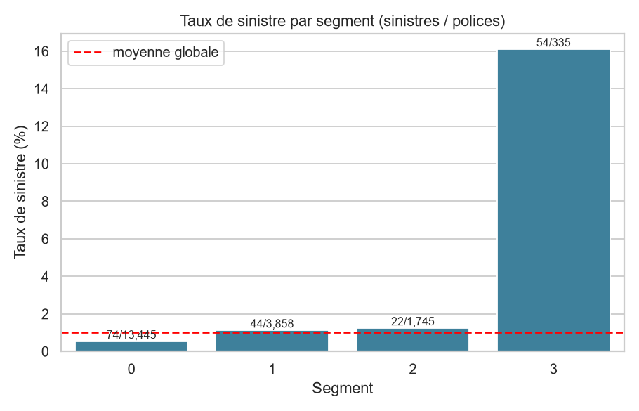
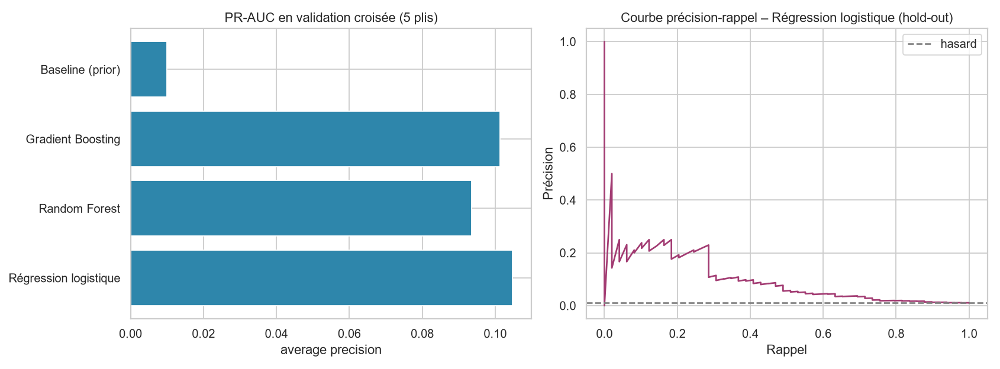

# Assurance voyage : segmentation et prédiction des sinistres

Projet de data science / machine learning sur un jeu de données d'assurance voyage (21 300 polices, 11 variables) d'une entreprise basée à Singapour.
Le projet couvre tout le cycle : **nettoyage → analyse exploratoire avec tests statistiques → clustering (K-Means, CAH) → modèles de classification** sur une cible très déséquilibrée (≈ 1 % de sinistres).

## Résultats principaux

| Thème | Résultat |
|---|---|
| Données | 21 300 → **19 383 polices** après suppression de 1 896 doublons, 1 ligne vide et 20 durées ≤ 0 |
| Cible | **194 sinistres (1,0 %)** : l'accuracy est inutilisable, on évalue par PR-AUC et rappel dans le top-décile |
| Facteurs liés au sinistre | durée, prime (`Net_Sales`), commission, type d'agence, agence et produit (tests de Mann-Whitney / χ², p < 1e-18). L'âge et le canal de distribution ne sont **pas** discriminants |
| Segmentation | 4 segments ; un segment de séjours très longs (≈ 1 an) représente **1,7 % des polices mais 28 % des sinistres** (taux 16 % vs 1 % global) |
| Prédiction | ROC-AUC ≈ 0,81, PR-AUC ≈ 0,10 (**10× le hasard**). Les 10 % de polices les mieux classées contiennent ≈ 53 % des sinistres (hold-out) |




> Les chiffres sont recalculés à chaque exécution (`reports/results.json`) ; les commentaires du notebook ont été vérifiés contre ces sorties.

## Structure du dépôt

```
├── data/
│   ├── raw/travel_insurance_raw.csv        # données d'origine, non modifiées
│   └── processed/                          # données nettoyées + segments (générés)
├── notebooks/analyse_assurance_voyage.ipynb   # démarche commentée, sorties incluses
├── travel_insurance/                       # code réutilisable
│   ├── data.py        # chargement + nettoyage (règles documentées)
│   ├── eda.py         # statistiques, tests, figures
│   ├── clustering.py  # K-Means, CAH (Ward), profils de segments
│   └── modeling.py    # pipelines sklearn, validation croisée, importance
├── tests/             # tests pytest du nettoyage
├── reports/           # figures + results.json
└── run_pipeline.py    # exécute tout, de bout en bout
```

## Installation et exécution

```bash
python -m venv .venv && source .venv/bin/activate   # Windows : .venv\Scripts\activate
pip install -r requirements.txt

python run_pipeline.py          # régénère données nettoyées, figures et résultats (~30 s)
jupyter notebook notebooks/analyse_assurance_voyage.ipynb
pytest                          # tests
```

## Choix méthodologiques

- **Pas d'imputation inventée** : `Gender` est manquant à 78,6 %. Il est conservé comme catégorie `Unknown` plutôt qu'imputé par le mode. Il se trouve que le genre n'est *jamais* renseigné par les agences EPX, CWT et SSI : « genre inconnu » est un proxy de l'agence, pas une information sur le client.
- **Valeurs bouchon** : `Age = 118` est traité comme manquant ; 42,6 % des âges valent exactement 36 (valeur par défaut probable), ce qui limite toute conclusion sur l'âge.
- **Winsorisation uniquement dans le clustering** (K-Means est sensible aux extrêmes) ; le fichier nettoyé garde les valeurs d'origine.
- **Pas de fuite de données** : tout le prétraitement du modèle est dans un `Pipeline` sklearn réappris à chaque pli ; les doublons sont supprimés avant la séparation train/test.
- **Déséquilibre** : pondération des classes, validation croisée stratifiée, métriques adaptées (PR-AUC, rappel@top-k).
- **Choix de k = 4** : la silhouette est maximale pour k = 2 (0,58) puis plateau ≈ 0,45 ; k = 4 est un choix métier assumé (isole le segment à haut risque), pas une optimisation.

## Limites

- Seulement 194 sinistres : forte variance entre plis (± 0,05 de PR-AUC), les trois modèles testés ne sont pas statistiquement distinguables.
- Les doublons exacts ont été supposés être des erreurs ; ils pourraient être des polices légitimes distinctes.
- Corrélation ≠ causalité (produit, agence et durée sont fortement liés). Pas de dimension temporelle, donc pas de validation « dans le futur ».
- Le modèle sert à **prioriser** (contrôle, tarification), pas à décider seul.

## Données

## Données

Projet réalisé dans le cadre du cours Machine Learning, faculté des sciences de Bizerte, 2026.
Le jeu de données travel_insurance_raw.csv a été fourni par l'enseignante. Il est inclus ici à des fins pédagogiques uniquement.
L'analyse, le code et la rédaction sont mon travail personnel.

## Licence

Code sous licence MIT (voir `LICENSE`). La licence des données reste celle de leur source.
